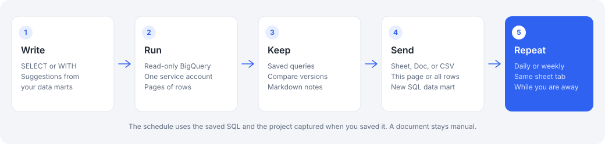

# SQL-Console

Check a BigQuery result and hand it over as a Google Sheet or Doc, before anyone creates an OWOX report.

An analyst often needs an answer today: a number, a slice, a list. A report is a data mart, a destination, the report itself, and sometimes a schedule. SQL-Console stays inside the project and uses what is already there: BigQuery storages, data marts you can open, and one service account. You write the query, see the rows, and export.



## Where it is the faster job

| You need | In SQL-Console | What you skip |
| --- | --- | --- |
| Check a figure | Run one read-only query and page the rows. The same result opens again for about 24 hours. | A data mart and a report for a question nobody else will rerun. |
| Drop rows into a Sheet or Doc | Export this page, or up to 100,000 rows, into a spreadsheet. A Doc gets a heading and a table at the end, up to 2,000 cells. | A Google Sheets destination, a sheet id, and a report run. A Doc is not a report destination. |
| Refresh one tab every day or week | Save the query, export once so the tab exists, and pick the time. The run keeps going while SQL-Console is closed. | A SQL data mart, a Sheets destination, a report, and a report-run trigger. |
| Find a table you already model | Suggestions offer `project.dataset.table` from tables, views, and connector tables behind data marts you can open, then the fields of those tables. | Looking the names up outside the project. They come from data marts you can already open. |
| Keep the draft | Every save keeps the SQL. Compare any two versions, and leave a Markdown note of up to 2,500 characters. | Editing a published data mart just to test a question. |
| Make it official | Create a SQL data mart from this query and open it. That is the step into OWOX. | Retyping a query that already worked. |
| Try a change safely | Import a SQL data mart, or the SQL a report will run. Edit and run it here, then update that data mart when the new SQL is the one you want. A report is not written back. | Changing the data mart before you have seen the rows. |

CSV of the current page is the smallest hand-off: one file, no Sheet and no report.

## When a report is the right tool

Use a report when the number is shared and should stay the project's source of truth, when other people filter or rerun it, or when the Sheet should refresh through a destination's own Google account. SQL-Console writes with the plugin service account, to files that account can already edit. It does not replace that report.

## What a run can do

| | |
| --- | --- |
| Preview | Page through the result. Clear cache forgets the saved job and does not delete a BigQuery table. |
| Download | CSV of the current preview page. A later page is a separate file. |
| Export | Replace a sheet tab, or add a new one and leave the other tabs as they are. Several queries can share one spreadsheet. |
| Schedule | Daily or weekly replacement of that sheet. A document stays a manual export. Pause, resume, and delete also live under Plugins → Schedules. |
| Project | Pick a BigQuery storage to fill the GCP project and location, or type them. Leave location empty and BigQuery chooses. |

The query is one `SELECT` or `WITH`. The credential can run jobs and read tables. It cannot change BigQuery data.

## AI assistant

Open the AI panel next to the editor and chat about the query that is open: rewrite it, explain it, fix an error, add a filter. When the answer changes the SQL, it shows the full query with **Apply**, **Run**, and **Save** actions, so the new SQL lands in the editor, runs in the preview, or is kept as a version in one click. Each saved query keeps its own chat history.

The assistant runs on Claude through the **Anthropic** Credential you add in OWOX Data Marts and select when SQL-Console is installed. The plugin never sees the token: the chat request goes from your browser to the plugin's Cloudflare Worker, the worker calls Anthropic with the Credential handle, and only the reply text comes back.

## Before the first export

The plugin uses the Google Service Account Credential you select at install. OWOX keeps the key. A storage's own key is not used.

1. Grant that account **BigQuery Job User** on the GCP project and **BigQuery Data Viewer** on the tables.
2. Enable the BigQuery, Sheets, Docs, and Drive APIs on the project that owns the key.
3. Open the Sheet or Doc, choose Share, and add the service account as Editor. SQL-Console lists files that account can already open. It cannot share a file for you.

A Storage that signs in with Google OAuth still needs this separate service account.

## Install

1. Create a **Google Service Account** Credential and paste the JSON key.
2. Open **Plugins → Publish Plugin**.
3. Enter `romandubovyi/sql-console`, choose who can see it, then **Publish & Install**.
4. Select that Credential when the install dialog asks for it.

Installing tells you that scheduled runs use the installing member's access, including while the plugin is closed. The page is on GitHub Pages. The schedule action runs on a Cloudflare Worker.

## Develop

```bash
npm install
npm test
npm run lint
npm run build
```
